# PocketGuitar

> 一款基于 Android 原生开发的智能吉他演奏与 AI 结构化谱曲工具，集成**和弦面板、指弹面板、和弦库**以及**「自然语言 → 结构化曲谱 → 实时自动弹奏」**的 AI 创作闭环。

---

## 核心特性

* **和弦面板（Chord Panel）**：支持常用和弦快速切换与扫弦/分解弹奏，辅助伴奏练习。
* **指弹面板（Fingerstyle Panel）**：基于自定义 `FretboardView` 还原吉他指板交互，支持多点触控按弦与实时视觉反馈。
* **和弦库（Chord Library）**：内置标准和弦指法与结构化定义，支持检索与试听。
* **AI 谱曲与自动弹奏（AI Compose & Auto-Play）**：输入自然语言描述（风格、情绪、调性或节奏），接入 OpenAI 兼容大模型生成结构化曲谱 JSON，经容错解析与音高指法映射后，直接驱动吉他音频引擎自动演奏。

---

## 系统架构与 AI 谱曲链路

项目将「开放式自然语言生成」收敛为「强类型曲谱中间表示（IR）」，再投影到端侧音频执行器，实现模型输出与演奏逻辑解耦：

```mermaid
flowchart LR
  U["用户输入自然语言需求"] --> C["ComposeActivity<br/>拼装 COMPOSE_SYSTEM_PROMPT"]
  C --> AI["AiClient (OkHttp)<br/>OpenAI 兼容 /v1/chat/completions<br/>stream=true"]
  AI --> SSE["ChatSseParser<br/>增量流式解析 (BOM/CRLF/多行 data/[DONE])"]
  SSE --> PARSE["SongParser<br/>extractJson() 去代码块/赘述 + Gson 映射"]
  PARSE --> IR["Song 强类型曲谱对象<br/>title / key / bpm / sections / melody"]
  IR --> MAP["NoteMapper<br/>音名 → MIDI → 弦/品映射"]
  MAP --> PLAY["StringPlayer (SoundPool)<br/>六弦 WAV + 半音变调播放"]
  PLAY --> UI["FretboardView<br/>指板动画与实时演奏反馈"]
```



---

## 核心技术亮点

### 1. AI 结构化输出契约与容错解析
* **系统提示词约束**：在 `ComposeActivity` 中通过 `COMPOSE_SYSTEM_PROMPT` 隔离系统规则与用户输入，明确约束曲谱 JSON 字段骨架（`title`、`key`、`bpm`、`timeSignature`、`sections`、`melody`）以及吉他有效音域（`E2`–`E5`）。
* **手写增量 SSE 解析器（`ChatSseParser`）**：完整处理流式传输协议边界，包括 UTF-8 BOM、CRLF 换行、注释行、多行 `data:` 聚合、`[DONE]` 终止标记以及流自然结束时的 `flush()`，避免将单个 delta 误作完整载荷。
* **双保险容错解析（`SongParser`）**：针对大模型可能附带的 Markdown 代码围栏或前后解释性文本，`extractJson()` 自动剥离代码块并精准截取首个 `{` 至末尾 `}`；`parse()` 结合 Gson 完成强类型对象映射，异常统一收口为 `AiModelException(Kind.PROTOCOL)`，防止脏数据进入播放层。
* **网络健壮性控制**：`AiClient` 配置明确的超时边界（连接 15s / 读取 90s / 写入 30s）与响应体大小上限（错误体 8 KiB / 非流式体 2 MiB），所有网络请求均在后台线程异步执行。

### 2. 自定义指板交互与端侧音频引擎
* **自定义指板渲染（`FretboardView`）**：基于 Android 原生 `Canvas` 实现指板位图拼接绘制、多点触控事件分发以及按弦同心圆晕开动画。
* **十二平均律半音变调播放（`StringPlayer`）**：基于 `SoundPool` 加载六根空弦 WAV 采样资源，利用十二平均律半音比率 $2^{1/12} \approx 1.0594631$ 动态计算各品位对应的播放速率（`rate`），兼顾低延迟响应与包体体积控制。
* **乐理到物理指法映射（`NoteMapper`）**：完成音高字符串（如 `C4`、`G#3`）到 MIDI 编号的解析，并通过 `findStringFret()` 将旋律音符映射为可弹奏的「弦 + 品」物理位置。

---

## 核心模块概览

```text
app/src/main/java/.../
├── ComposeActivity.java          # AI 谱曲入口、System Prompt 定义与生成流程编排
├── FingerstyleActivity.java      # 指弹面板与曲谱自动演奏调度
├── ai/
│   ├── AiClient.java             # OpenAI 兼容 Chat Completions 流式客户端 (OkHttp)
│   ├── AiModelConfig.java        # 模型配置与默认 System Prompt 兜底
│   ├── AiModelException.java     # 统一模型与协议异常分类
│   ├── ChatSseParser.java        # 手写 SSE 协议增量解析器
│   └── ChatCompletionJson.java   # 流式 delta.content 抽取
├── music/
│   ├── Song.java                 # 曲谱根对象 (SongSection / MelodyNote)
│   ├── SongParser.java           # 容错 JSON 抽取、反序列化与文本渲染
│   ├── NoteMapper.java           # 音名 → MIDI → 吉他弦/品位映射
│   └── SongPlaybackManager.java  # 跨页面曲谱播放状态管理
└── ui / audio/
    ├── FretboardView.java        # 自定义 Canvas 指板控件（多点触控 + 动画）
    └── StringPlayer.java         # SoundPool 六弦音频加载与半音变调播放器
```

---

## 快速开始

### 环境要求
* Android Studio Hedgehog 及以上
* JDK 11+ / Gradle 8+
* Android 手机或模拟器（建议真机以获得更低的音频播放延迟）

### 配置与运行
1. 克隆仓库并在 Android Studio 中打开工程：
   ```bash
   git clone https://github.com/<your-username>/PocketGuitar.git
   ```
2. 同步 Gradle 依赖（核心依赖：AndroidX、Material、OkHttp、Gson）。
3. 运行 App 后，在 AI 谱曲配置页填入你的 **OpenAI 兼容 API Endpoint、Model 名称及 API Key**（本地调试配置，请勿将真实 Key 提交至版本库）。
4. 在「AI 谱曲」页输入曲风描述（例如：*“一首 90 BPM、C 大调的温暖民谣分解和弦”*），等待曲谱生成后即可点击试听自动弹奏。

---

## 工程边界与后续演进（Roadmap）

为保证文档与真实代码边界一致，当前版本的已知边界及后续优化方向如下：

* [ ] **语义级曲谱校验与自动修复**：当前 `SongParser` 已覆盖 JSON 语法与非空校验，后续计划补齐 BPM 合理区间、拍号合法性、和弦白名单及 `E2`–`E5` 音域强校验，并在校验失败时携带错误信息触发有限次自动修复重试。
* [ ] **流式进度反馈与后台解析**：计划将 JSON 解析与曲谱文本渲染完全移至后台线程，并结合 `onDelta` 回调在界面展示实时生成进度，进一步优化长曲谱场景下的主线程流畅度。
* [ ] **本地曲谱库与离线评测集**：计划增加本地曲谱持久化管理，并建立固定 Prompt 回归测试集，量化评估不同模型下的协议通过率、字段完整率与可弹奏率。

---

## License

MIT License